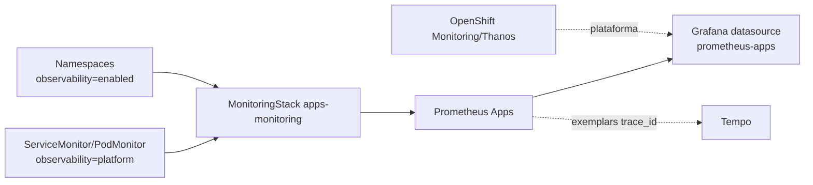

# Prometheus Apps GitOps

Prometheus dedicado para métricas de aplicações no OpenShift Local/CRC,
gerenciado pelo Red Hat OpenShift Cluster Observability Operator via
`MonitoringStack`.

## Arquitetura



O desenho mantém dois papéis claros:

- OpenShift Monitoring continua responsável pela plataforma, operadores e
  compatibilidade nativa do OpenShift;
- `prometheus-apps` coleta workloads selecionados que precisam de customização,
  exemplares e correlação com Tempo.

## Decisão sobre User Workload Monitoring

| Alternativa | Vantagem | Risco |
|---|---|---|
| Manter apenas User Workload Monitoring | menor número de componentes | requer conferir suporte às customizações e aos exemplares desejados |
| Desativar User Workload Monitoring e usar este stack | reduz duplicidade e consumo no CRC | exige padronizar labels `observability=*` |
| Usar Prometheus dedicado para tudo | máxima customização | replica responsabilidades da plataforma e exige mais manutenção |
| Modelo recomendado | OpenShift Monitoring para plataforma + Prometheus Apps para workloads | exige labels e documentação para evitar coleta duplicada |

Recomendação para CRC: manter o monitoramento nativo do OpenShift para
plataforma, deixar User Workload Monitoring desativado por padrão e usar este
Prometheus dedicado para aplicações que exigem exemplares, métricas RED, Service
Graph e integrações avançadas no Grafana.

## Seletores

O stack coleta apenas:

- namespaces com `observability=enabled`;
- recursos de scrape/regras com `observability=platform`.

Exemplo de `ServiceMonitor` compatível:

```yaml
apiVersion: monitoring.rhobs/v1
kind: ServiceMonitor
metadata:
  labels:
    observability: platform
spec:
  endpoints:
    - port: metrics
      interval: 30s
```

## Deploy

Este repositório é consumido pelo app-of-apps do `argocd-gitops`. Para aplicar
manualmente em laboratório:

```bash
oc apply -k overlays/desenvolvimento
```

Valide:

```bash
oc -n observability-apps get monitoringstack,pods,svc,pvc
oc -n observability-apps port-forward svc/apps-monitoring-prometheus 9090:9090
curl -fsS 'http://127.0.0.1:9090/api/v1/query?query=up'
```

## Exemplares

Para armazenar exemplares OpenMetrics com `trace_id` e `span_id`, confira se o Prometheus gerado pelo MonitoringStack habilita exemplar-storage. Consulte os flags no runtime; não deduza essa configuração apenas do manifesto MonitoringStack.

Valide a flag:

```bash
oc -n observability-apps exec prometheus-apps-monitoring-0 -c prometheus -- \
  curl -fsS http://127.0.0.1:9090/api/v1/status/flags
```

O retorno esperado contém:

```json
{
  "enable-feature": "exemplar-storage"
}
```

Valide a existência de exemplares recentes:

```bash
START=$(($(date +%s)-3600))
END=$(date +%s)

oc -n observability-apps exec prometheus-apps-monitoring-0 -c prometheus -- \
  curl -fsS "http://127.0.0.1:9090/api/v1/query_exemplars?query=%7B__name__%3D~%22.%2B%22%7D&start=${START}&end=${END}"
```

Quando a integração está funcionando, a resposta inclui séries com exemplares e
labels como `trace_id` e `span_id`. O `grafana-gitops` configura o datasource
`Prometheus-Apps` com `exemplarTraceIdDestinations` apontando para o datasource
`tempo`, tornando os exemplares clicáveis no Grafana.

## Estrutura

```text
base/                         Operator, namespace, MonitoringStack e regras
overlays/desenvolvimento/     perfil CRC com 10Gi e retenção de 15 dias
overlays/aceite/              retenção/armazenamento maiores para homologação
overlays/producao/            placeholders de sizing para produção
docs/                         decisões e validação por ambiente
```

## Secrets

Este stack não versiona credenciais. O acesso interno do Grafana ao Service
`apps-monitoring-prometheus` usa rede do cluster. Se o ambiente exigir
autenticação, crie um Secret específico no namespace `grafana` e referencie-o no
datasource do `grafana-gitops`.

## Segurança e operação

- seletores explícitos evitam coleta duplicada acidental;
- NetworkPolicy permite acesso do namespace `grafana` ao Prometheus;
- `Alertmanager` fica desabilitado no CRC para reduzir consumo;
- `createClusterRoleBindings` é usado pelo Operator para descoberta
  multi-namespace e deve ser revisado antes de produção;
- ajuste PVC, retenção e HA de acordo com storage e SLO reais.

## Referências

- [Red Hat OpenShift Cluster Observability Operator](https://docs.redhat.com/en/documentation/red_hat_openshift_cluster_observability_operator/1-latest/html/about_red_hat_openshift_cluster_observability_operator/index)
- [Configurar COO para monitorar serviços](https://docs.redhat.com/en/documentation/red_hat_openshift_cluster_observability_operator/1-latest/html/installing_red_hat_openshift_cluster_observability_operator/configuring-the-cluster-observability-operator-to-monitor-a-service)
- [Prometheus exemplar storage](https://prometheus.io/docs/prometheus/latest/feature_flags/)

## Coleta opcional de Istio e Envoy

O laboratório [service-mesh-gitops](https://github.com/thiagobotelho/service-mesh-gitops) reutiliza apps-monitoring. Seus monitores devem usar **monitoring.rhobs/v1**, label `observability=platform`, em namespaces `observability=enabled`. Há também CRDs de monitoring.coreos.com no cluster; criar um monitor nesse outro grupo não comprova coleta pelo Prometheus do COO.

PodMonitor de Envoy: porta nomeada http-envoy-prom, caminho /stats/prometheus, container istio-proxy. ServiceMonitor de Istiod: http-monitoring, /metrics. Validar os nomes nos pods/Services da revisão real. O cenário combinado libera scrape na porta 15090 sem abrir a aplicação 8080. Não criar outro Prometheus nem ampliar seletores globalmente. Após instalar o Mesh, confira targets e séries antes de usar os painéis.


## Aprender a configuração

Consulte o [guia comentado](docs/APRENDIZADO.md) para entender componentes, escolhas, testes positivos/negativos e reversão.

## Diagnóstico integrado de rede e mesh

Consulte o [guia de observabilidade do mesh](https://github.com/thiagobotelho/service-mesh-gitops/blob/main/docs/OBSERVABILIDADE.md) para correlacionar NetworkPolicy, logs de proxies, mTLS, autorização HTTP e traces, com as fontes de dados corretas.
