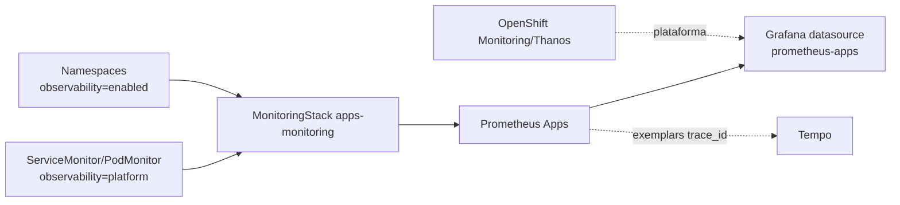

# Prometheus Apps GitOps

Prometheus dedicado para métricas de aplicações no OpenShift Local/CRC,
gerenciado pelo Red Hat OpenShift Cluster Observability Operator via
`MonitoringStack`.

## Arquitetura



O desenho mantém dois papéis claros:

- OpenShift Monitoring/User Workload Monitoring continua responsável pela
  plataforma, operadores e compatibilidade nativa do OpenShift;
- `prometheus-apps` coleta workloads selecionados que precisam de customização,
  exemplares e correlação com Tempo.

## Decisão sobre User Workload Monitoring

| Alternativa | Vantagem | Risco |
|---|---|---|
| Manter apenas User Workload Monitoring | menor número de componentes | não atende customizações/exemplares necessárias no CRC atual |
| Remover User Workload Monitoring | reduz duplicidade | perde integração suportada do OpenShift e aumenta risco operacional |
| Usar Prometheus dedicado para tudo | máxima customização | replica responsabilidades da plataforma e exige mais manutenção |
| Modelo híbrido recomendado | separa plataforma e aplicações customizadas | exige labels e documentação para evitar coleta duplicada |

Recomendação: manter o monitoramento nativo do OpenShift para plataforma e usar
este Prometheus dedicado para aplicações que exigem exemplares, métricas RED,
Service Graph e integrações avançadas no Grafana.

## Seletores

O stack coleta apenas:

- namespaces com `observability=enabled`;
- recursos de scrape/regras com `observability=platform`.

Exemplo de `ServiceMonitor` compatível:

```yaml
apiVersion: monitoring.rhobs/v1
kind: ServiceMonitor
metadata:
  labels:
    observability: platform
spec:
  endpoints:
    - port: metrics
      interval: 30s
```

## Deploy

Este repositório é consumido pelo app-of-apps do `argocd-gitops`. Para aplicar
manualmente em laboratório:

```bash
oc apply -k overlays/desenvolvimento
```

Valide:

```bash
oc -n observability-apps get monitoringstack,pods,svc,pvc
oc -n observability-apps port-forward svc/apps-monitoring-prometheus 9090:9090
curl -fsS 'http://127.0.0.1:9090/api/v1/query?query=up'
```

## Estrutura

```text
base/                         Operator, namespace, MonitoringStack e regras
overlays/desenvolvimento/     perfil CRC com 10Gi e retenção de 15 dias
overlays/aceite/              retenção/armazenamento maiores para homologação
overlays/producao/            placeholders de sizing para produção
docs/                         decisões e validação por ambiente
```

## Secrets

Este stack não versiona credenciais. O acesso interno do Grafana ao Service
`apps-monitoring-prometheus` usa rede do cluster. Se o ambiente exigir
autenticação, crie um Secret específico no namespace `grafana` e referencie-o no
datasource do `grafana-gitops`.

## Segurança e operação

- seletores explícitos evitam coleta duplicada acidental;
- NetworkPolicy permite acesso do namespace `grafana` ao Prometheus;
- `Alertmanager` fica desabilitado no CRC para reduzir consumo;
- `createClusterRoleBindings` é usado pelo Operator para descoberta
  multi-namespace e deve ser revisado antes de produção;
- ajuste PVC, retenção e HA de acordo com storage e SLO reais.

## Referências

- [Red Hat OpenShift Cluster Observability Operator](https://docs.redhat.com/en/documentation/red_hat_openshift_cluster_observability_operator/1-latest/html/about_red_hat_openshift_cluster_observability_operator/index)
- [Configurar COO para monitorar serviços](https://docs.redhat.com/en/documentation/red_hat_openshift_cluster_observability_operator/1-latest/html/installing_red_hat_openshift_cluster_observability_operator/configuring-the-cluster-observability-operator-to-monitor-a-service)
- [Prometheus exemplar storage](https://prometheus.io/docs/prometheus/latest/feature_flags/)
